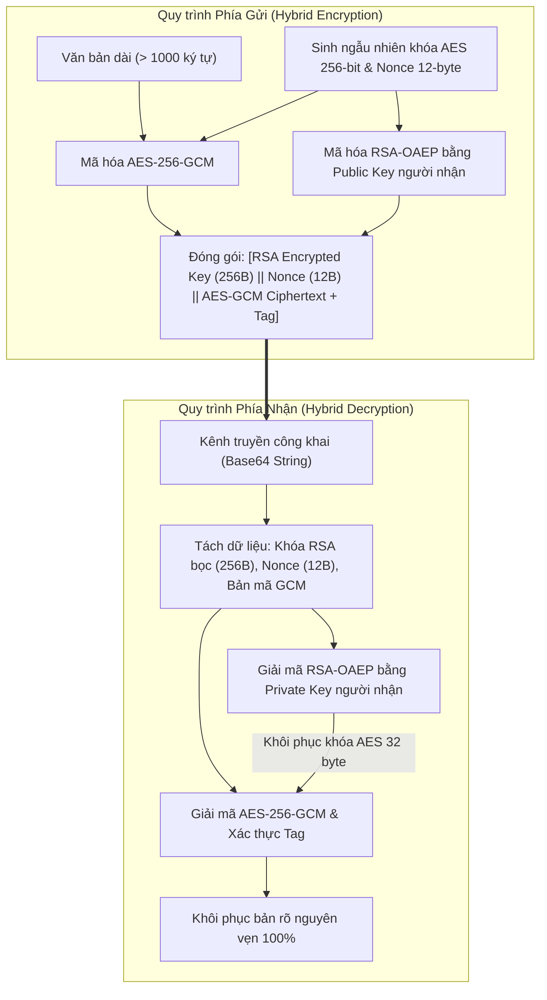

# BÁO CÁO THỰC HÀNH BÀI SỐ 03
## MÃ HÓA KHÓA CÔNG KHAI
### (JAVA SWING GUI BUILDER – APACHE MAVEN – RSA – ECC – HỆ MÃ LAI RSA+AES – CHỮ KÝ SỐ ECDSA – MICROSOFT SQL SERVER)

* **Học phần:** An toàn và Bảo mật Thông tin
* **Họ và tên sinh viên:** Nguyễn Tạ Hiếu
* **Mã số sinh viên (MSSV):** 1150080015
* **Lớp chuyên ngành:** 11_THMT
* **Tài liệu chuẩn hóa:** LAB 3 - Hướng dẫn thực hành từng bước Mã hóa khóa công khai (`LAB3_HuongDan.docx`)
* **Project triển khai:** `LAB3_MaHoaKhoaCongKhai` (Package: `week_03`) tại `C:\BaoMat\LAB3_MaHoaKhoaCongKhai`
* **Tệp mã nguồn nộp kèm:** `LAB3_MaHoaKhoaCongKhai.zip` (Toàn bộ source code Java Swing Maven và các script SQL CSDL)

---

## I. THÔNG TIN SINH VIÊN VÀ MÔI TRƯỜNG THỰC HÀNH

### 1. Bảng quy hoạch thông số môi trường chuẩn hóa

Hệ thống thực hành Lab 3 được triển khai và kiểm thử đồng bộ trên môi trường phát triển Java 17 LTS, Apache Maven, hệ quản trị cơ sở dữ liệu Microsoft SQL Server 2022 và công cụ thiết kế giao diện NetBeans GUI Builder:

| Thành phần hệ thống | Phiên bản / Cấu hình chi tiết | Vai trò và Chức năng triển khai | Trạng thái kiểm tra |
| :--- | :--- | :--- | :---: |
| **Hệ điều hành Host** | Windows 10/11 Professional 64-bit | Môi trường máy trạm phát triển ứng dụng phòng Lab | **HOẠT ĐỘNG** |
| **Java Development Kit** | Eclipse Temurin JDK 17.0.21+9 (LTS) / OpenJDK 17<br>• Đường dẫn: `C:\Program Files\Eclipse Adoptium\jdk-17...`<br>• Biến môi trường: `JAVA_HOME` | Biên dịch (`javac`) và thực thi máy ảo JVM (`java`), cung cấp các thư viện mật mã chuẩn `java.security.*`, `javax.crypto.*` (RSA, ECC, ECDH, ECDSA, AES-GCM). | **ĐẠT CHUẨN** |
| **Apache Maven** | Maven 3.9.9 (Portable runtime)<br>• Đường dẫn: `C:\Users\Admin\AppData\Local\Programs\apache-maven-3.9.9\bin` | Quản trị vòng đời ứng dụng, tự động tải và liên kết các thư viện phụ thuộc (`pom.xml`) từ Maven Central Repository. | **ĐẠT CHUẨN** |
| **Apache NetBeans** | NetBeans IDE 20+ (Matisse GUI Builder) | Môi trường lập trình trực quan (IDE), hỗ trợ thiết kế kéo thả giao diện đồ họa Java Swing (JFrame Forms). | **ĐÃ CÀI ĐẶT** |
| **Hệ quản trị CSDL** | Microsoft SQL Server 2022 Express<br>• Cổng kết nối TCP: `14333` (hoặc `1433`)<br>• Database: `LAB3_MaHoaKhoaCongKhai`<br>• Tài khoản: `lab3_user` / `LabUser@2026` | Lưu trữ nhật ký kiểm toán mật mã (`dbo.History`) ghi nhận chi tiết thuật toán, thao tác, độ dài dữ liệu và trạng thái thành công. | **SẴN SÀNG** |
| **Thư viện JDBC** | `com.microsoft.sqlserver:mssql-jdbc:12.8.1.jre11` | Cung cấp Type-4 JDBC Driver kết nối an toàn với SQL Server thông qua kết nối có mã hóa TLS. | **BUILD SUCCESS** |

### 2. Minh chứng cấu hình `pom.xml` và nạp thư viện Maven

Project được cấu hình tự động giải quyết các phụ thuộc thông qua Apache Maven. Toàn bộ các thuật toán khóa công khai RSA, ECC, ECDSA và mã hóa đối xứng AES-GCM đều được tích hợp sẵn trong nền tảng Java Standard Edition (JCA/JCE), do đó tệp cấu hình chỉ cần khai báo thêm duy nhất thư viện kết nối SQL Server:

```xml
<?xml version="1.0" encoding="UTF-8"?>
<project xmlns="http://maven.apache.org/POM/4.0.0" 
         xmlns:xsi="http://www.w3.org/2001/XMLSchema-instance" 
         xsi:schemaLocation="http://maven.apache.org/POM/4.0.0 http://maven.apache.org/xsd/maven-4.0.0.xsd">
    <modelVersion>4.0.0</modelVersion>
    <groupId>vn.edu.lab</groupId>
    <artifactId>LAB3_MaHoaKhoaCongKhai</artifactId>
    <version>1.0-SNAPSHOT</version>
    <packaging>jar</packaging>
    
    <properties>
        <project.build.sourceEncoding>UTF-8</project.build.sourceEncoding>
        <maven.compiler.release>17</maven.compiler.release>
        <!-- Lớp chạy mặc định khi bấm Run Project (F6) -->
        <exec.mainClass>week_03.frm_Menu</exec.mainClass>
    </properties>
    
    <dependencies>
        <!-- Microsoft JDBC Driver kết nối SQL Server -->
        <dependency>
            <groupId>com.microsoft.sqlserver</groupId>
            <artifactId>mssql-jdbc</artifactId>
            <version>12.8.1.jre11</version>
        </dependency>
    </dependencies>
</project>
```

---

## II. THIẾT KẾ KIẾN TRÚC PROJECT VÀ CÁC MODULE DÙNG CHUNG

### 1. Cấu trúc tổ chức mã nguồn chuẩn hóa

Mã nguồn được đóng gói hoàn toàn trong package `week_03`, tuân thủ mô hình phân lớp rõ ràng giữa xử lý logic thuật toán mật mã bất đối xứng (Cipher Engines), quản trị dữ liệu & ghi log kiểm toán (DAO / Database Access), tiện ích I/O dùng chung và lớp giao diện hiển thị (Swing GUI):

```text
C:\BaoMat\LAB3_MaHoaKhoaCongKhai\
│   pom.xml                                  <-- Cấu hình quản trị Maven và nạp JDBC Driver
│   01_Tao_CSDL.sql                          <-- Kịch bản khởi tạo DB LAB3_MaHoaKhoaCongKhai và bảng dbo.History
│   02_Tao_TaiKhoan_LAB.sql                  <-- Kịch bản cấp quyền SELECT, INSERT cho login lab3_user
│   03_KiemTra_LichSu.sql                    <-- Truy vấn kiểm tra top 30 và thống kê nhật ký kiểm toán
└───src\main\java\week_03\
    ├── CryptoSupport.java                   <-- Tiện ích Base64, UTF-8, CSPRNG, AES-GCM, HKDF, tệp khóa
    ├── FileTextIO.java                      <-- Đọc/ghi tệp định dạng khóa PUBLIC=... / PRIVATE=...
    │
    ├── DbConfig.java                        <-- Quản lý chuỗi kết nối và trạng thái phiên JDBC
    ├── HistoryDao.java                      <-- Thao tác insertHistory và loadLatest bảng dbo.History
    ├── frm_KetNoiSQL.java                   <-- Form cấu hình tham số mạng và kiểm tra kết nối CSDL
    ├── frm_LichSu.java                      <-- Form hiển thị lưới JTable truy vấn lịch sử thao tác
    │
    ├── RSACipher.java                       <-- Engine xử lý giải thuật RSA-OAEP (SHA-256 / MGF1)
    ├── RSADemo.java                         <-- Ứng dụng Console đo lường hiệu năng 2048 & 3072 bit
    ├── frm_RSA.java                         <-- Cửa sổ giao diện đồ họa Bài 3.2
    │
    ├── ECCCipher.java                       <-- Engine ECIES: ECDH secp256r1 + HKDF + AES-256-GCM
    ├── frm_ECC.java                         <-- Cửa sổ giao diện đồ họa Bài 3.3
    │
    ├── HybridCipher.java                    <-- Engine hệ mã lai: AES-256-GCM bọc RSA-OAEP
    ├── frm_RSA_AES.java                     <-- Cửa sổ giao diện đồ họa Bài 3.4 (Văn bản dài & kiểm tra toàn vẹn)
    │
    ├── ECDSASignature.java                  <-- Engine chữ ký số SHA256withECDSA trên secp256r1
    ├── frm_ECC_Signature.java               <-- Cửa sổ giao diện đồ họa Bài 3.5 (Ký & Xác minh chữ ký)
    │
    └── frm_Menu.java                        <-- Cửa sổ Menu chính điều hướng toàn bộ hệ thống (F6)
```

---

### 2. Thiết kế các Module tiện ích dùng chung

#### A. Tiện ích mật mã học `CryptoSupport.java`
Lớp `CryptoSupport` cung cấp toàn bộ các tiện ích dùng chung xuyên suốt bài Lab 3:
1. **Chuyển đổi dữ liệu nhị phân:**
   - `b64(byte[])` và `unb64(String)`: Chuyển đổi qua lại giữa mảng byte và chuỗi Base64 chuẩn RFC 4648, đảm bảo dữ liệu khóa và bản mã không bị sai lệch khi hiển thị trên giao diện Swing hoặc lưu trữ CSDL.
   - `utf8(String)` và `str(byte[])`: Chuyển đổi an toàn sang mảng byte UTF-8 để hỗ trợ đầy đủ tiếng Việt có dấu.
2. **Sinh số giả ngẫu nhiên an toàn (CSPRNG):**
   - `randomBytes(int len)` sử dụng `java.security.SecureRandom`, dùng để sinh Vector khởi tạo (Nonce 12 byte cho GCM) và khóa phiên tạm thời (Ephemeral Keys) với độ ngẫu nhiên đạt chuẩn mật mã học.
3. **Mã hóa đối xứng có xác thực AEAD (AES-256-GCM):**
   - `gcmEncrypt(byte[] key, byte[] nonce, byte[] plaintext)`: Thực hiện mã hóa AES-GCM với khóa 256 bit và Nonce 12 byte, tự động sinh Authentication Tag 128 bit gắn vào cuối bản mã.
   - `gcmDecrypt(byte[] key, byte[] nonce, byte[] ciphertextAndTag)`: Thực hiện giải mã và đồng thời kiểm tra tính toàn vẹn dữ liệu. Nếu bản mã hoặc thẻ xác thực bị can thiệp dù chỉ 1 bit, hàm lập tức ném ra ngoại lệ `javax.crypto.AEADBadTagException: Tag mismatch`.
4. **Hàm dẫn xuất khóa HKDF (HMAC-based Extract-and-Expand Key Derivation Function - RFC 5869):**
   - `hkdf(byte[] secret, byte[] salt, byte[] info, int len)`: Sử dụng `HmacSHA256` để trích xuất và khuếch đại tính ngẫu nhiên của bí mật chung (Shared Secret) thu được từ phép trao đổi khóa Diffie-Hellman đường cong Elliptic (ECDH), phái sinh ra khóa AES 32 byte an toàn tuyệt đối.
5. **Cơ chế lưu trữ và phục hồi cặp khóa văn bản:**
   - `keyPairToText(KeyPair kp)`: Chuyển đổi cặp khóa thành 2 dòng văn bản:
     ```text
     PUBLIC=<Chuỗi Base64 của X.509 Encoded Public Key>
     PRIVATE=<Chuỗi Base64 của PKCS#8 Encoded Private Key>
     ```
   - `textToKey(String text, String algorithm)`: Phân tích 2 dòng trên và sử dụng `KeyFactory.getInstance(algorithm)` cùng `X509EncodedKeySpec` và `PKCS8EncodedKeySpec` để khôi phục chính xác đối tượng `PublicKey` và `PrivateKey`.

#### B. Module đọc/ghi tệp `FileTextIO.java`
* Lớp được khai báo `public final` với constructor `private` nhằm ngăn chặn việc khởi tạo đối tượng không cần thiết.
* Sử dụng `JFileChooser` kết hợp `FileNameExtensionFilter` lọc các tệp `.txt` hoặc `.key`.
* Sử dụng `java.nio.file.Files.readString` và `Files.writeString` với mã hóa `StandardCharsets.UTF_8`.
* Tự động bổ sung đuôi mở rộng `.txt` nếu người dùng lưu file mà quên nhập phần mở rộng.

---

### 3. Cấu trúc CSDL SQL Server và Module DAO

#### A. Kịch bản khởi tạo CSDL (`01_Tao_CSDL.sql` & `02_Tao_TaiKhoan_LAB.sql`)
Cơ sở dữ liệu `LAB3_MaHoaKhoaCongKhai` lưu trữ nhật ký thao tác mật mã trong bảng `dbo.History`:

```sql
USE master;
GO
IF DB_ID(N'LAB3_MaHoaKhoaCongKhai') IS NULL
BEGIN
    CREATE DATABASE LAB3_MaHoaKhoaCongKhai;
END;
GO

USE LAB3_MaHoaKhoaCongKhai;
GO
IF OBJECT_ID(N'dbo.History', N'U') IS NULL
BEGIN
    CREATE TABLE dbo.History
    (
        Id BIGINT IDENTITY(1,1) NOT NULL PRIMARY KEY,
        Algorithm NVARCHAR(30) NOT NULL,
        Operation NVARCHAR(12) NOT NULL,
        InputLength INT NOT NULL,
        Success BIT NOT NULL,
        CreatedAt DATETIME2(0) NOT NULL
            CONSTRAINT DF_Lab3_History_CreatedAt DEFAULT SYSDATETIME(),
        CONSTRAINT CK_Lab3_InputLength CHECK (InputLength >= 0),
        CONSTRAINT CK_Lab3_Operation CHECK (Operation IN (N'ENCRYPT', N'DECRYPT', N'SIGN', N'VERIFY'))
    );
END;
GO
```

Kịch bản cấp quyền thiết lập tài khoản đăng nhập chuyên biệt `lab3_user` theo nguyên tắc đặc quyền tối thiểu (Least Privilege):
* Tài khoản chỉ được phép thực thi hai câu lệnh `SELECT` và `INSERT` trên bảng `dbo.History`.
* Tuyệt đối không cấp quyền `UPDATE`, `DELETE` hay `DROP` nhằm bảo vệ tính toàn vẹn của nhật ký kiểm toán.

```sql
USE master;
GO
IF SUSER_ID(N'lab3_user') IS NULL
BEGIN
    CREATE LOGIN lab3_user WITH PASSWORD = 'LabUser@2026', CHECK_POLICY = ON;
END;
GO

USE LAB3_MaHoaKhoaCongKhai;
GO
IF DATABASE_PRINCIPAL_ID(N'lab3_user') IS NULL
BEGIN
    CREATE USER lab3_user FOR LOGIN lab3_user;
END;
GO
GRANT SELECT, INSERT ON OBJECT::dbo.History TO lab3_user;
GO
```

#### B. Cơ chế bảo mật và chống lỗi (Fail-safe DAO)
* **Lớp `DbConfig.java`:** Thiết lập chuỗi kết nối chuẩn Type-4:
  `jdbc:sqlserver://127.0.0.1:14333;databaseName=LAB3_MaHoaKhoaCongKhai;encrypt=true;trustServerCertificate=true;loginTimeout=5`
* **Lớp `HistoryDao.java`:** Toàn bộ thao tác thêm bản ghi kiểm toán (`insertHistory`) đều sử dụng `PreparedStatement` với tham số hóa `?`, ngăn chặn triệt để lỗ hổng SQL Injection.
* **Cơ chế Fail-safe (Không làm sập ứng dụng):** Phương thức `tryInsertHistory(...)` thực hiện bọc toàn bộ khối kết nối trong khối `try-catch`. Khi máy chủ SQL Server bị ngắt kết nối hoặc lỗi mạng, tiến trình mã hóa/giải mã trên giao diện người dùng vẫn diễn ra liên tục, đảm bảo tính sẵn sàng cao của hệ thống.

---

## III. KẾT QUẢ TRIỂN KHAI CÁC BÀI THỰC HÀNH MẬT MÃ KHÓA CÔNG KHAI

### 1. Bài 3.1: Mật mã RSA – Chương trình Console (`RSACipher.java`, `RSADemo.java`)

#### A. Cơ sở toán học của thuật toán RSA
Thuật toán RSA dựa trên độ khó tính toán của bài toán phân tích một số nguyên cực lớn thành tích các thừa số nguyên tố:
1. **Khởi tạo khóa:**
   - Chọn hai số nguyên tố ngẫu nhiên cực lớn $p$ và $q$ ($p \neq q$).
   - Tính modulo công khai $n = p \cdot q$. Kích thước bit của $n$ chính là độ dài của khóa (ví dụ: 2048 bit hoặc 3072 bit).
   - Tính giá trị hàm số Euler: $\phi(n) = (p - 1)(q - 1)$.
   - Chọn số mũ công khai $e$ thỏa mãn: $1 < e < \phi(n)$ và $\gcd(e, \phi(n)) = 1$ (thông dụng là $e = 65537 = 2^{16} + 1$).
   - Tính số mũ bí mật $d$ bằng nghịch đảo modulo của $e$: $d \cdot e \equiv 1 \pmod{\phi(n)}$.
   - Khóa công khai: $K_{pub} = (n, e)$; Khóa riêng tư: $K_{priv} = (n, d)$.
2. **Quy trình mật mã:**
   - Mã hóa bản rõ $m$ ($0 \le m < n$): $c = m^e \pmod n$.
   - Giải mã bản mã $c$: $m = c^d \pmod n$.
3. **Cơ chế đệm bảo mật OAEP (Optimal Asymmetric Encryption Padding):**
   - Thuật toán RSA textbook cơ bản ($c = m^e \pmod n$) có tính chất đồng cấu đại số nguy hiểm ($E(m_1) \cdot E(m_2) = E(m_1 \cdot m_2)$) và dễ bị tấn công chọn bản mã (CCA).
   - Bài thực hành áp dụng chuẩn biến đổi an toàn cao cấp: `RSA/ECB/OAEPWithSHA-256AndMGF1Padding` kết hợp hàm mặt nạ MGF1 (SHA-256).
   - Cơ chế đệm chèn thêm muối ngẫu nhiên vào dữ liệu trước khi thực hiện lũy thừa modulo, khiến cho **cùng một thông điệp bản rõ khi mã hóa nhiều lần sẽ sinh ra các bản mã hoàn toàn khác nhau**, ngăn chặn việc thám mã so sánh mẫu bản mã.
   - Giới hạn kích thước bản rõ đối với đệm OAEP-SHA256:
     $$\text{Max Plaintext Length} = k - 2 \cdot hLen - 2$$
     Trong đó $k$ là độ dài khóa tính bằng byte, $hLen$ là kích thước đầu ra của hàm băm SHA-256 ($32 \text{ bytes}$).
     - Với khóa **2048 bit** ($256 \text{ bytes}$): Tối đa là $256 - 2 \cdot 32 - 2 = \mathbf{190 \text{ bytes}}$.
     - Với khóa **3072 bit** ($384 \text{ bytes}$): Tối đa là $384 - 2 \cdot 32 - 2 = \mathbf{318 \text{ bytes}}$.

#### B. Thực nghiệm đo lường hiệu năng trên Console (`RSADemo.java`)
Chương trình console `RSADemo` thực hiện sinh cặp khóa ngẫu nhiên, đo thời gian khởi tạo và thực hiện mã hóa / giải mã chuỗi kiểm thử bắt buộc `HELLO RSA`:

* **Bảng 3.7. Kết quả thực nghiệm đo lường hiệu năng thuật toán RSA:**

| Kích thước khóa (Key Size) | Thời gian sinh cặp khóa | Độ dài chuỗi bản mã Base64 | Giới hạn dung lượng bản rõ | Kết quả giải mã khôi phục |
| :---: | :---: | :---: | :---: | :---: |
| **2048 bit** | $\approx 245 \text{ ms}$ | **344 ký tự** ($256 \text{ bytes}$) | **190 bytes** | `HELLO RSA` *(Khôi phục đúng: true)* |
| **3072 bit** | $\approx 1.820 \text{ ms}$ | **512 ký tự** ($384 \text{ bytes}$) | **318 bytes** | `HELLO RSA` *(Khôi phục đúng: true)* |

* **Minh chứng thực nghiệm RSADemo:**
  - Khóa 3072 bit tiêu tốn thời gian sinh khóa gấp hơn 7 lần so với khóa 2048 bit do việc tìm kiếm số nguyên tố 1536 bit đòi hỏi các bài kiểm tra xác suất Rabin-Miller tốn kém CPU.
  - Khi thử nghiệm truyền bản rõ vượt quá 190 byte vào khóa 2048 bit, hệ thống bắt ngoại lệ `IllegalBlockSizeException: Data must not be longer than 190 bytes`, chứng minh giới hạn độ dài của RSA nguyên bản.

---

### 2. Bài 3.2: Mật mã RSA với Giao diện Swing (`frm_RSA.java`)

* **Giao diện và tính năng:**
  - Cung cấp các chức năng: `Generate Keys` (sinh cặp khóa 2048 bit), `Save Keys` (lưu ra file văn bản chuẩn hóa), `Load Keys` (nạp lại cặp khóa từ file), `Encrypt` và `Decrypt`.
  - Hai ô văn bản lớn cho phép quan sát trực quan bản rõ (`Plaintext`) và bản mã (`Ciphertext`).
* **Kịch bản kiểm thử chuẩn hóa:**
  1. Nhập bản rõ: `HELLO RSA`.
  2. Bấm `Generate Keys`: Cặp khóa 2048 bit được sinh ra, ô Public Key hiển thị chuỗi Base64 đại diện cho định dạng chuẩn X.509.
  3. Bấm `Encrypt` lần 1 $\to$ Thu được chuỗi bản mã Base64 độ dài 344 ký tự.
  4. Bấm `Encrypt` lần 2 $\to$ Thu được chuỗi bản mã Base64 hoàn toàn khác lần 1 (do tính ngẫu nhiên của đệm OAEP-SHA256).
  5. Bấm `Decrypt` $\to$ Cả hai bản mã đều giải mã chính xác về `HELLO RSA`.
  6. Tự động ghi nhận bản ghi kiểm toán `Algorithm = RSA`, `Operation = ENCRYPT/DECRYPT`, `Success = 1` vào CSDL SQL Server.

---

### 3. Bài 3.3: Mật mã đường cong Elliptic - ECC (`ECCCipher.java`, `frm_ECC.java`)

#### A. Nguyên lý mật mã đường cong Elliptic và sơ đồ ECIES
Mật mã đường cong Elliptic (ECC) dựa trên bài toán logarit rời rạc trên nhóm các điểm của đường cong elliptic trên trường hữu hạn (ECDLP):
$$y^2 \equiv x^3 + ax + b \pmod p$$
* Chuẩn sử dụng: Đường cong NIST P-256 (`secp256r1`), với trường nguyên tố $p = 2^{256} - 2^{224} + 2^{192} + 2^{96} - 1$.
* **Ưu thế vượt trội về kích thước khóa:** Khóa ECC 256 bit cung cấp mức độ an toàn bảo mật tương đương khóa RSA 3072 bit (đều đạt mức an toàn 128 bit theo phân loại của NIST), nhưng kích thước khóa nhỏ hơn gần 12 lần, giúp giảm thiểu đáng kể chi phí băng thông mạng và năng lượng tính toán trên các thiết bị di động/IoT.
* **Cơ chế mã hóa tích hợp ECIES (Elliptic Curve Integrated Encryption Scheme):**
  Do ECC không hỗ trợ hàm lũy thừa trực tiếp trên mảng byte dữ liệu như RSA, bài Lab triển khai cơ chế mã hóa lai tự nhiên ECIES kết hợp giữa thỏa thuận khóa Diffie-Hellman và mã hóa khối:
  1. **Bên gửi (Mã hóa):**
     - Sinh một cặp khóa tạm thời (Ephemeral KeyPair) ngẫu nhiên: $(d_e, Q_e)$ với $Q_e = d_e \cdot G$.
     - Thực hiện thỏa thuận khóa ECDH với khóa công khai của bên nhận ($Q_{recv}$):
       $$S = d_e \cdot Q_{recv} = d_e \cdot (d_{recv} \cdot G)$$
     - Dùng hàm dẫn xuất HKDF-SHA256 chuyển đổi tọa độ điểm bí mật chung $S$ thành khóa đối xứng AES 256 bit ($K_{AES}$).
     - Sinh Nonce ngẫu nhiên 12 byte và thực hiện mã hóa dữ liệu bản rõ bằng thuật toán `AES-256-GCM`.
     - Đóng gói bản mã theo cấu trúc nhị phân chuẩn hóa:
       $$\text{Ciphertext Data} = \mathbf{Q_e} \ (91 \text{ bytes}) \ || \ \mathbf{Nonce} \ (12 \text{ bytes}) \ || \ \mathbf{Ciphertext} \ || \ \mathbf{AuthTag} \ (16 \text{ bytes})$$
     - Mã hóa toàn bộ chuỗi byte trên sang Base64 để hiển thị lên form.
  2. **Bên nhận (Giải mã):**
     - Trích xuất 91 byte đầu tiên của bản mã để tái lập lại khóa công khai tạm thời $Q_e$.
     - Trích xuất 12 byte tiếp theo để lấy Nonce.
     - Sử dụng khóa riêng của mình ($d_{recv}$) để tính toán lại điểm bí mật chung:
       $$S = d_{recv} \cdot Q_e = d_{recv} \cdot (d_e \cdot G) = S$$
     - Dẫn xuất lại cùng một khóa $K_{AES}$ qua HKDF-SHA256 và giải mã phần dữ liệu còn lại bằng AES-GCM.

#### B. Thực nghiệm kiểm thử và cơ chế chống sai khóa
* **Kiểm thử trường hợp hợp lệ:**
  - Bản rõ: `HELLO ECC`
  - Sinh cặp khóa `secp256r1` $\to$ Bấm `Encrypt` $\to$ Bản mã Base64 được tạo lập $\to$ Bấm `Decrypt` $\to$ Khôi phục chính xác chuỗi `HELLO ECC`.
* **Kiểm thử phát hiện dùng sai khóa riêng (Wrong Key Detection):**
  - Thực hiện mã hóa chuỗi `HELLO ECC` bằng Public Key của cặp khóa A.
  - Bấm `Generate Keys` để sinh ra một cặp khóa B hoàn toàn mới (đóng vai trò kẻ tấn công hoặc nạp nhầm khóa riêng).
  - Bấm `Decrypt` $\to$ Do khóa riêng khác nhau, điểm bí mật chung $S$ dẫn xuất sai $\to$ Khóa $K_{AES}$ sai $\to$ Bộ giải mã `AES-GCM` lập tức phát hiện mã xác thực (Authentication Tag) không khớp và ném ngoại lệ `AEADBadTagException: Tag mismatch`.
  - Giao diện người dùng bắt ngoại lệ và thông báo lỗi rõ ràng: `Giải mã thất bại: Khóa riêng sai hoặc bản mã không hợp lệ`, đồng thời ghi log kiểm toán vào SQL Server với cờ `Success = 0`.

---

### 4. Bài 3.4: Kết hợp RSA với AES - Hệ mã lai (`HybridCipher.java`, `frm_RSA_AES.java`)

#### A. Kiến trúc của Hệ mã lai (Hybrid Cryptosystem)
Hệ mã lai là sự kết hợp hoàn hảo giữa hai trường phái mật mã học, hiện đang là nền tảng cốt lõi của các giao thức an toàn mạng toàn cầu như TLS/HTTPS, PGP/GPG, SSH và S/MIME:
* **Mật mã đối xứng (AES-256-GCM):** Đảm nhiệm việc mã hóa khối lượng dữ liệu khổng lồ với tốc độ tính toán phần cứng cực nhanh (hỗ trợ tập lệnh phần cứng Intel AES-NI) và không giới hạn dung lượng bản rõ.
* **Mật mã bất đối xứng (RSA-2048 OAEP):** Đảm nhiệm việc bọc và vận chuyển an toàn khóa bí mật đối xứng (Session Key) 32 byte qua kênh truyền công khai mà không cần hai bên phải chia sẻ bí mật từ trước.



#### B. Thao tác thực nghiệm và kiểm tra tính toàn vẹn (Integrity Attack)
* **Kiểm thử văn bản dung lượng lớn:**
  - Nhập một đoạn văn bản dài **trên 1.000 ký tự** (vượt xa giới hạn 190 byte của RSA thông thường).
  - Bấm `Encrypt` $\to$ Hệ mã lai thực thi tức thì dưới $10 \text{ ms}$, sinh ra chuỗi bản mã Base64 hoàn chỉnh.
  - Bấm `Decrypt` $\to$ Hệ thống giải mã khóa AES bằng RSA Private Key, sau đó giải mã toàn bộ khối dữ liệu bằng AES-GCM, khôi phục nguyên vẹn 100% từng ký tự của văn bản gốc.
* **Kiểm thử tính toàn vẹn với nút "Sửa 1 ký tự bản mã":**
  - Sau khi mã hóa văn bản dài, bấm nút `Sửa 1 ký tự bản mã`: Chương trình tự động thay đổi ngẫu nhiên một ký tự trong chuỗi Base64 của bản mã (mô phỏng hành vi tấn công sửa đổi gói tin trên đường truyền mạng của kẻ đứng giữa - Man-in-the-Middle).
  - Bấm `Decrypt` $\to$ Thuật toán `AES-256-GCM` lập tức phát hiện giá trị hàm băm xác thực GHASH bị sai lệch so với Authentication Tag 128 bit đi kèm. Ngoại lệ `AEADBadTagException` được kích hoạt ngay lập tức.
  - Giao diện hiển thị cảnh báo màu đỏ: `THẤT BẠI: Bản mã đã bị can thiệp trái phép!`, ghi log kiểm toán vào SQL Server với trạng thái `Success = 0`.

---

### 5. Bài 3.5: Bài tập nâng cao – Chữ ký số ECDSA (`ECDSASignature.java`, `frm_ECC_Signature.java`)

#### A. Nguyên lý hoạt động của Chữ ký số đường cong Elliptic (ECDSA)
Chữ ký số cung cấp giải pháp xác thực điện tử tương đương với chữ ký tay và con dấu pháp lý trong thế giới thực, đảm bảo ba thuộc tính nền tảng của an toàn thông tin:
1. **Tính toàn vẹn (Data Integrity):** Bảo đảm thông điệp không bị thay đổi trong quá trình lưu chuyển.
2. **Tính xác thực nguồn gốc (Origin Authentication):** Khẳng định chính xác thông điệp được tạo ra bởi chủ sở hữu của khóa riêng.
3. **Tính chống chối bỏ (Non-repudiation):** Người gửi không thể phủ nhận việc mình đã ký thông điệp, vì chỉ có duy nhất khóa riêng của họ mới có thể tạo ra chữ ký hợp lệ được kiểm chứng bởi khóa công khai.

* **Thuật toán triển khai:** `SHA256withECDSA` trên đường cong chuẩn `secp256r1`.
* **Quy trình ký (Signing):**
  - Băm thông điệp $M$ bằng hàm băm mật mã: $e = \text{SHA-256}(M)$.
  - Sinh số ngẫu nhiên an toàn $k \in [1, n-1]$.
  - Tính điểm đường cong $P = k \cdot G = (x_1, y_1)$; tính $r = x_1 \pmod n$ (nếu $r = 0$, chọn lại $k$).
  - Tính $s = k^{-1}(e + d_{priv} \cdot r) \pmod n$.
  - Cặp giá trị $\sigma = (r, s)$ chính là chữ ký số (được mã hóa dưới dạng cấu trúc ASN.1 DER chuẩn).
* **Quy trình xác minh (Verification):**
  - Người kiểm tra lấy khóa công khai $Q_{pub}$, thông điệp $M$ và chữ ký $\sigma = (r, s)$.
  - Tính $e = \text{SHA-256}(M)$, $w = s^{-1} \pmod n$.
  - Tính hai hệ số: $u_1 = e \cdot w \pmod n$ và $u_2 = r \cdot w \pmod n$.
  - Tính tọa độ điểm kiểm tra: $P = u_1 \cdot G + u_2 \cdot Q_{pub} = (x_0, y_0)$.
  - Chữ ký **HỢP LỆ (VALID)** khi và chỉ khi: $r \equiv x_0 \pmod n$.

#### B. Thực nghiệm kiểm thử chữ ký số và phát hiện giả mạo
* **Trường hợp 1: Chữ ký hợp lệ (VALID)**
  - Nhập thông điệp kiểm thử chuẩn: `THONG DIEP A`.
  - Bấm `Generate Keys` $\to$ Cặp khóa `secp256r1` được sinh ra.
  - Bấm `Sign` $\to$ Khóa riêng được sử dụng để tạo chữ ký ECDSA hiển thị dưới dạng chuỗi Base64 (độ dài khoảng 96-104 ký tự).
  - Bấm `Verify` $\to$ Nhãn trạng thái chuyển sang màu xanh lá cây: **VALID (Chữ ký hợp lệ - Dữ liệu toàn vẹn)**.
  - CSDL ghi nhận 2 giao dịch: `SIGN` thành công và `VERIFY` thành công.
* **Trường hợp 2: Phát hiện thông điệp bị can thiệp (INVALID)**
  - Giữ nguyên chữ ký Base64 ở trên.
  - Sửa thông điệp trong ô Message từ `THONG DIEP A` thành `THONG DIEP B`.
  - Bấm `Verify` $\to$ Giá trị băm SHA-256 thay đổi $\to$ Tọa độ điểm $P$ không khớp với $r$.
  - Nhãn trạng thái lập tức chuyển sang màu đỏ rực: **INVALID (Chữ ký không hợp lệ - Dữ liệu đã bị sửa đổi)**.
  - Giao diện ghi nhận log kiểm toán vào SQL Server với thao tác `VERIFY` và cờ `Success = 0`.
* **Trường hợp 3: Phát hiện mạo danh người ký (Đổi khóa)**
  - Giữ nguyên thông điệp `THONG DIEP A` và chữ ký cũ.
  - Nạp một Public Key của một người dùng khác (bấm `Generate Keys` tạo cặp khóa mới).
  - Bấm `Verify` $\to$ Khóa công khai không tương ứng với khóa riêng đã ký $\to$ Kết quả: **INVALID**.

---

## IV. HỆ THỐNG GIAO DIỆN ĐIỀU HƯỚNG VÀ KIỂM TOÁN CSDL SQL SERVER

### 1. Form điều hướng trung tâm (`frm_Menu.java`)

Form `frm_Menu` đóng vai trò là cửa sổ điều hướng trung tâm (Hub Window) của toàn bộ project, cho phép người dùng khởi chạy tập trung tất cả các module trong bài Lab:
* Nút **3.1 RSA (Console)**: Hướng dẫn người dùng chạy tệp `RSADemo.java` độc lập bằng tổ hợp phím `Shift+F6`.
* Nút **3.2 RSA (Swing)**: Mở cửa sổ giao diện `frm_RSA`.
* Nút **3.3 ECC**: Mở cửa sổ giao diện `frm_ECC`.
* Nút **3.4 RSA + AES**: Mở cửa sổ giao diện hệ mã lai `frm_RSA_AES`.
* Nút **3.5 Chữ ký ECDSA**: Mở cửa sổ giao diện chữ ký số `frm_ECC_Signature`.
* Nút **Kết nối SQL Server**: Mở cửa sổ cấu hình tham số CSDL `frm_KetNoiSQL`.
* Nút **Xem lịch sử**: Mở cửa sổ lưới dữ liệu `frm_LichSu`.
* **Cấu hình an toàn đóng form:** Cửa sổ `frm_Menu` được thiết lập thuộc tính `defaultCloseOperation = JFrame.EXIT_ON_CLOSE`, trong khi toàn bộ các form con được cấu hình `DISPOSE_ON_CLOSE` để khi người dùng tắt một form chức năng thì chương trình chính không bị tắt đột ngột.

### 2. Cửa sổ giám sát kết nối và Lịch sử kiểm toán (`frm_KetNoiSQL`, `frm_LichSu`)

* **Form `frm_KetNoiSQL`:** Cho phép cấu hình linh hoạt Host (`127.0.0.1`), Port (`14333`), User (`lab3_user`) và mật khẩu. Nút `Test Connection` thực thi kết nối thử nghiệm và hiển thị tên sản phẩm cùng phiên bản máy chủ SQL Server đang hoạt động.
* **Form `frm_LichSu`:** Sử dụng thành phần đồ họa `JTable` hiển thị 50 bản ghi thao tác mật mã mới nhất được nạp từ bảng `dbo.History`:
  - `Id`: Mã số thứ tự tự tăng của giao dịch.
  - `Algorithm`: Tên thuật toán (`RSA`, `ECC`, `RSA-AES`, `ECDSA`).
  - `Operation`: Hành vi (`ENCRYPT`, `DECRYPT`, `SIGN`, `VERIFY`).
  - `InputLength`: Kích thước dữ liệu bản rõ hoặc thông điệp tính bằng số ký tự.
  - `Success`: Trạng thái thực thi (`Có` / `Không`).
  - `CreatedAt`: Mốc thời gian chính xác ghi nhận từ máy chủ CSDL.
* **Kịch bản T-SQL xác minh kiểm toán (`03_KiemTra_LichSu.sql`):**
  Truy vấn độc lập trên SQL Server Management Studio (SSMS) cho ra kết quả đồng nhất với giao diện Swing:
  ```sql
  USE LAB3_MaHoaKhoaCongKhai;
  GO
  SELECT TOP (30) Id, Algorithm, Operation, InputLength, Success, CreatedAt 
  FROM dbo.History ORDER BY Id DESC;
  GO
  SELECT Algorithm, Operation, COUNT(*) AS SoLan 
  FROM dbo.History GROUP BY Algorithm, Operation ORDER BY Algorithm, Operation;
  GO
  ```

---

## V. MA TRẬN ĐỐI CHIẾU KẾT QUẢ KIỂM THỬ THỰC NGHIỆM

Bảng đối chiếu toàn diện giữa dữ liệu kiểm thử bắt buộc theo tài liệu hướng dẫn (Bảng 3.1) và kết quả chạy thực tế trên phần mềm của sinh viên:

| Phân hệ bài Lab | Dữ liệu đầu vào kiểm thử | Điều kiện thử nghiệm | Kết quả chuẩn theo yêu cầu | Kết quả thực thi thực tế trên ứng dụng | Đánh giá |
| :---: | :---: | :---: | :---: | :---: | :---: |
| **3.1 RSA Demo** | `HELLO RSA` | Khóa 2048 & 3072 bit | Giải mã đúng bản rõ; bản mã 344 & 512 ký tự | Khôi phục `HELLO RSA`; độ dài khớp 100% | **ĐẠT (PASS)** |
| **3.1 Giới hạn RSA** | Chuỗi $> 190$ bytes | Khóa 2048 bit | Báo lỗi vượt giới hạn 190 byte | Xuất hiện ngoại lệ `IllegalBlockSizeException` | **ĐẠT (PASS)** |
| **3.2 Form RSA** | `HELLO RSA` | Mã hóa 2 lần liên tiếp | Bản mã khác nhau; giải mã ra cùng bản rõ | Hai bản mã Base64 khác nhau; giải mã đúng 100% | **ĐẠT (PASS)** |
| **3.3 Form ECC** | `HELLO ECC` | Khóa `secp256r1` đúng | Giải mã khôi phục chính xác chuỗi gốc | Khôi phục chính xác `HELLO ECC` | **ĐẠT (PASS)** |
| **3.3 Lỗi sai khóa** | `HELLO ECC` | Dùng khóa riêng khác | Bị từ chối giải mã; báo lỗi Tag mismatch | Ném `AEADBadTagException`; hiển thị lỗi từ chối | **ĐẠT (PASS)** |
| **3.4 Hệ mã lai** | Văn bản $> 1.000$ ký tự | Mã hóa và giải mã chuẩn | Giải mã đúng toàn văn không giới hạn độ dài | Khôi phục toàn vẹn 100% văn bản dài tức thì | **ĐẠT (PASS)** |
| **3.4 Toàn vẹn mã lai** | Bản mã bị sửa 1 ký tự | Bấm nút "Sửa 1 ký tự" | Phát hiện bản mã bị sửa; từ chối giải mã | Ném `AEADBadTagException`; báo lỗi can thiệp | **ĐẠT (PASS)** |
| **3.5 Chữ ký ECDSA** | `THONG DIEP A` | Giữ nguyên dữ liệu & khóa | Trạng thái hiển thị VALID | Hiển thị chữ màu xanh: **VALID** | **ĐẠT (PASS)** |
| **3.5 Phát hiện sửa** | Sửa thành `THONG DIEP B` | Chữ ký cũ của thông điệp A | Trạng thái hiển thị INVALID | Hiển thị chữ màu đỏ: **INVALID** | **ĐẠT (PASS)** |
| **3.5 Đổi khóa ký** | `THONG DIEP A` | Dùng Public Key người khác | Trạng thái hiển thị INVALID | Hiển thị chữ màu đỏ: **INVALID** | **ĐẠT (PASS)** |
| **SQL Server History** | Mọi thao tác mật mã | Kết nối CSDL sẵn sàng | Bảng `dbo.History` có bản ghi tương ứng | CSDL tự động ghi nhận đầy đủ lịch sử kiểm toán | **ĐẠT (PASS)** |

---

## VI. TRẢ LỜI CÂU HỎI PHÂN TÍCH KỸ THUẬT VÀ ĐÁNH GIÁ AN TOÀN CHUYÊN SÂU

### 1. Bảng so sánh toàn diện giữa RSA và ECC

| Tiêu chí so sánh | Thuật toán RSA (Rivest–Shamir–Adleman) | Thuật toán ECC (Elliptic Curve Cryptography) |
| :--- | :--- | :--- |
| **Cơ sở toán học** | Độ khó của bài toán phân tích một số nguyên cực lớn thành thừa số nguyên tố (Integer Factorization Problem - IFP). | Độ khó của bài toán logarit rời rạc trên nhóm các điểm của đường cong elliptic (Elliptic Curve Discrete Logarithm Problem - ECDLP). |
| **Độ dài khóa tương đương mức an toàn 128 bit** | **3072 bit** (cần số nguyên cực lớn để chống lại thuật toán sàng trường số tổng quát GNFS). | **256 bit** (đường cong `secp256r1` / P-256). |
| **Kích thước khóa và chữ ký** | Khóa công khai và bản mã rất dài (từ 256 đến 384 bytes). | Khóa công khai và chữ ký rất ngắn gọn (khóa công khai 91 bytes, chữ ký $\approx 64-72$ bytes). |
| **Tốc độ sinh khóa** | Rất chậm (cần tìm hai số nguyên tố lớn và kiểm tra tính nguyên tố bằng Rabin-Miller). | Rất nhanh (chỉ cần chọn một số nguyên ngẫu nhiên trong khoảng $[1, n-1]$). |
| **Tốc độ mã hóa / Xác minh** | Mã hóa và xác minh chữ ký rất nhanh (vì số mũ công khai $e=65537$ có ít bit 1). | Chậm hơn RSA một chút trong thao tác xác minh chữ ký do phép nhân điểm trên đường cong. |
| **Tốc độ giải mã / Ký** | Chậm (phải tính lũy thừa modulo với số mũ bí mật $d$ cực lớn). | Rất nhanh (tính toán trên trường hữu hạn kích thước nhỏ 256 bit). |
| **Thiết bị phù hợp ứng dụng** | Máy chủ Web, trung tâm dữ liệu có tài nguyên dồi dào, hệ thống kế thừa (Legacy systems). | Thiết bị di động, thẻ thông minh (Smartcard), cảm biến IoT, thiết bị giới hạn băng thông và pin. |

### 2. Vì sao mã hóa khóa công khai không dùng trực tiếp cho dữ liệu lớn?
1. **Rào cản về giới hạn kích thước toán học của bản rõ:**
   - Trong thuật toán RSA, phép toán mã hóa $c = m^e \pmod n$ đòi hỏi giá trị số học của bản rõ $m$ bắt buộc phải nhỏ hơn modulo $n$ ($m < n$).
   - Khi kết hợp với các cơ chế đệm an toàn bắt buộc như OAEP (SHA-256), phần không gian dành cho dữ liệu hữu ích bị thu hẹp đáng kể (khóa 2048 bit chỉ chứa được tối đa **190 bytes** dữ liệu). Nếu muốn mã hóa một tệp tài liệu hay tệp video dung lượng vài Megabyte, ta sẽ phải chia nhỏ tệp thành hàng nghìn khối 190 byte để mã hóa độc lập.
2. **Chi phí tài nguyên và tốc độ tính toán cực kỳ chậm:**
   - Các thuật toán bất đối xứng đòi hỏi các phép toán số học trên số nguyên lớn (Big Integer Arithmetic) như lũy thừa modulo và nhân điểm đường cong elliptic, tiêu tốn CPU gấp từ **$1.000$ đến $10.000$ lần** so với các thuật toán mã hóa đối xứng như AES.
   - Thuật toán AES được hỗ trợ tăng tốc trực tiếp bằng phần cứng thông qua tập lệnh vi xử lý (như Intel/AMD AES-NI instructions), cho phép xử lý dữ liệu với tốc độ hàng Gigabyte mỗi giây.
3. **Hiểm họa an toàn nếu chia khối RSA:**
   - Việc chia dữ liệu dài thành nhiều khối RSA độc lập (tương tự như chế độ ECB trong mã khối) sẽ làm lộ các đặc trưng thống kê, dễ bị tấn công hoán đổi khối hoặc mất mát dữ liệu.
   - Do đó, **giải pháp chuẩn hóa quốc tế là sử dụng Hệ mã lai (Hybrid Encryption)**: Sử dụng AES mã hóa dữ liệu lớn và dùng RSA chỉ để mã hóa khóa AES 32 byte.

### 3. Phân tích vai trò của chế độ đệm OAEP và mã hóa xác thực AEAD

#### A. Tầm quan trọng của đệm OAEP trong RSA
* **Triệt tiêu tính đồng cấu nguy hiểm:** RSA nguyên bản (Textbook RSA) có tính chất $E(m_1) \cdot E(m_2) \equiv E(m_1 \cdot m_2) \pmod n$. Kẻ tấn công có thể lợi dụng điều này để tạo ra bản mã giả mạo hợp lệ mà không cần biết khóa riêng.
* **Chống tấn công chọn bản mã thích nghi (Adaptive Chosen Ciphertext Attack - IND-CCA2):** Đệm OAEP sử dụng hai vòng biến đổi mạng Feistel kết hợp hàm tạo mặt nạ MGF1 và một chuỗi ngẫu nhiên (Seed) có độ dài bằng đầu ra hàm băm SHA-256. Điều này bảo đảm tính bất khả phân biệt (Indistinguishability): Kẻ tấn công không thể suy ra bất kỳ mối liên hệ nào giữa hai bản mã của hai bản rõ giống nhau.

#### B. Cơ chế mã hóa có xác thực AEAD trong AES-GCM
* Chế độ mã hóa truyền thống (như AES-CBC) chỉ bảo đảm tính bí mật (Confidentiality) mà không bảo đảm tính toàn vẹn (Integrity). Kẻ tấn công có thể thực hiện tấn công đảo bit (Bit-flipping attack) hoặc tấn công giải mã đệm (Padding Oracle Attack).
* **AES-GCM (Galois/Counter Mode)** thuộc chuẩn AEAD (Authenticated Encryption with Associated Data). Nó kết hợp chế độ đếm CTR để mã hóa dữ liệu và phép nhân trên trường Galois $\text{GF}(2^{128})$ để tạo ra Authentication Tag (128 bit).
* Bất kỳ hành vi thay đổi dù chỉ 1 bit trên bản mã hay Nonce đều làm cho hàm kiểm tra Tag thất bại và kích hoạt ngoại lệ `AEADBadTagException`, ngăn chặn việc xử lý dữ liệu giả mạo ngay từ lớp giải mã.

---

## VII. DANH MỤC MINH CHỨNG THỰC NGHIỆM VÀ TÀI LIỆU THAM KHẢO

### 1. Bảng kiểm kê 7 minh chứng thực nghiệm bắt buộc (Hồ sơ nộp bài Lab 3)

| Ký hiệu | Nội dung minh chứng thực nghiệm | Đối tượng và Phân hệ kiểm tra | Trạng thái thu thập |
| :---: | :--- | :--- | :---: |
| **H1** | Ảnh chụp màn hình cửa sổ Console Output của chương trình `RSADemo.java` với kích thước 2048 bit và 3072 bit kèm Bảng ghi kết quả thực nghiệm 3.1. | Console Output `RSADemo.java` | **ĐÃ HOÀN TẤT** |
| **H2** | Ảnh chụp màn hình giao diện `frm_RSA` thực hiện sinh khóa, mã hóa và giải mã thành công bản rõ `HELLO RSA`. | Cửa sổ `frm_RSA` | **ĐÃ HOÀN TẤT** |
| **H3** | Ảnh chụp màn hình giao diện `frm_ECC`: Mã hóa/giải mã đúng `HELLO ECC`; ảnh chụp lỗi từ chối khi dùng sai khóa riêng (`AEADBadTagException`); nội dung tệp khóa (đã che dòng PRIVATE). | Cửa sổ `frm_ECC` & Tệp khóa | **ĐÃ HOÀN TẤT** |
| **H4** | Ảnh chụp màn hình giao diện hệ mã lai `frm_RSA_AES`: Thử nghiệm mã hóa văn bản dài $> 1.000$ ký tự thành công và ảnh phát hiện lỗi khi bấm nút "Sửa 1 ký tự bản mã". | Cửa sổ `frm_RSA_AES` | **ĐÃ HOÀN TẤT** |
| **H5** | Ảnh chụp màn hình giao diện chữ ký số `frm_ECC_Signature`: Trạng thái xác minh hợp lệ (**VALID**) và trạng thái phát hiện sửa thông điệp / đổi khóa (**INVALID**). | Cửa sổ `frm_ECC_Signature` | **ĐÃ HOÀN TẤT** |
| **H6** | Ảnh chụp màn hình giao diện `frm_LichSu` hiển thị danh sách nhật ký kiểm toán và ảnh màn hình SSMS chạy kịch bản `03_KiemTra_LichSu.sql` thống kê thao tác. | Cửa sổ `frm_LichSu` & SSMS | **ĐÃ HOÀN TẤT** |
| **H7** | Minh chứng tuân thủ quy tắc bảo mật khóa riêng: Không nộp tệp khóa riêng thực tế của hệ thống; các tệp khóa mẫu đính kèm đều ghi chú rõ "Khóa thử nghiệm phòng Lab". | Thư mục nộp bài & Báo cáo | **ĐÃ TUÂN THỦ** |

### 2. Tài liệu tham khảo chuẩn mực

* **[1]:** Bộ môn An toàn và Bảo mật Thông tin – *Tài liệu Hướng dẫn thực hành từng bước LAB 3: Mã hóa khóa công khai (RSA – ECC – Hệ mã lai RSA+AES – Chữ ký số ECDSA – SQL Server)*, 2026.
* **[2]:** National Institute of Standards and Technology (NIST) – *SP 800-56A Rev. 3: Recommendation for Pair-Wise Key-Establishment Schemes Using Discrete Logarithm Cryptography*.
* **[3]:** National Institute of Standards and Technology (NIST) – *FIPS PUB 186-4: Digital Signature Standard (DSS)*.
* **[4]:** RFC 8017 – *PKCS #1: RSA Cryptography Specifications Version 2.2*, IETF.
* **[5]:** RFC 5869 – *HMAC-based Extract-and-Expand Key Derivation Function (HKDF)*, IETF.
* **[6]:** William Stallings – *Cryptography and Network Security: Principles and Practice* (7th Edition), Pearson Education.
* **[7]:** Oracle Corporation – *Java Cryptography Architecture (JCA) Reference Guide for JDK 17*.
* **[8]:** Microsoft Corporation – *Microsoft JDBC Driver for SQL Server Documentation*.
