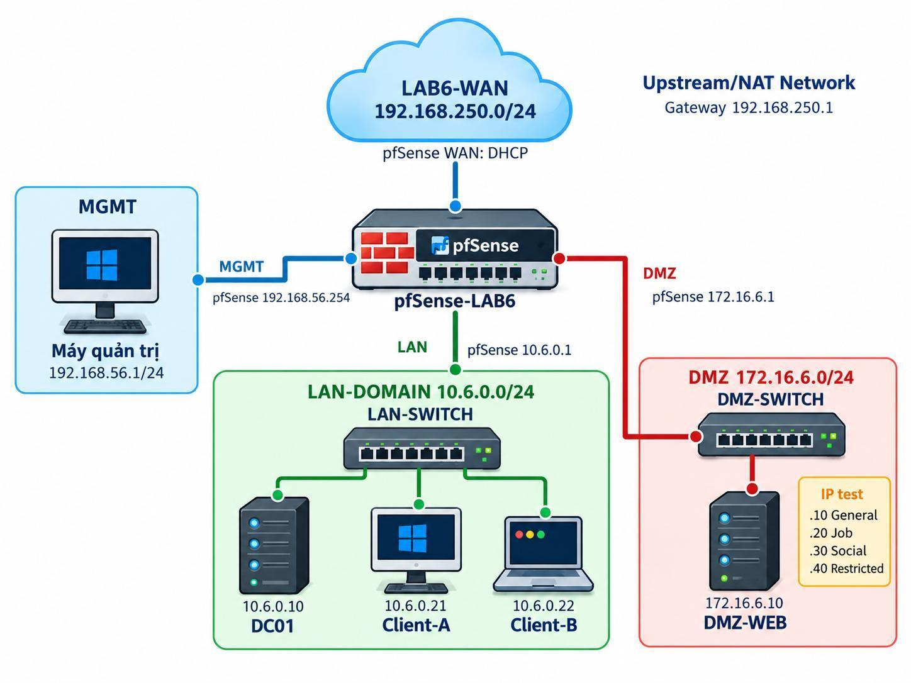

# BÁO CÁO BÀI THỰC HÀNH SỐ 6
## XÁC THỰC ACTIVE DIRECTORY VÀ CHÍNH SÁCH TRUY CẬP TRÊN pfSense
*(Active Directory/LDAP Authentication & Access Control Policies on pfSense Firewall)*

---

## I. THÔNG TIN SINH VIÊN VÀ MÔI TRƯỜNG THỰC HÀNH

* **Họ và tên:** Nguyễn Tạ Hiếu
* **Mã số sinh viên (MSSV):** 11500800015 *(hoặc 1150080015)*
* **Lớp:** 11_THMT
* **Học phần:** Thực hành An toàn Hệ thống Thông tin (AT HTTT)
* **Năm học:** 2026 – 2027
* **Kho lưu trữ (GitHub Repository):** `LAB_AT_BMHTTT/LAB6`

---

## II. MỤC TIÊU BÀI THỰC HÀNH

1. Dựng tường lửa mã nguồn mở **pfSense CE** riêng biệt cho LAB 6 với 4 interface: **WAN**, **MGMT**, **LAN** và **DMZ**.
2. Tích hợp pfSense với máy chủ dịch vụ thư mục **Active Directory (AD DS)** qua giao thức **LDAP** và kiểm tra xác thực người dùng tập trung bằng công cụ `Diagnostics > Authentication`.
3. Triển khai cổng xác thực **Captive Portal** trên giao diện LAN sử dụng Active Directory làm backend xác thực duy nhất.
4. Xây dựng các định danh logic **Firewall Alias** cho máy trạm, nhóm máy trạm và các nhóm website dịch vụ mô phỏng trong DMZ.
5. Thiết kế và kiểm thử các chính sách an toàn thông tin theo kịch bản tương đương giải pháp Sophos UTM/NGFW:
   * Chặn website theo từng máy người dùng.
   * Cấm nhóm website nguy hại cho toàn bộ máy trạm.
   * Phân quyền truy cập theo khung giờ quy định (**Firewall Schedule**).
   * Giới hạn dịch vụ mạng và kiểm soát luồng giao thức.
6. Hiểu rõ giới hạn kiến trúc: Bộ lọc gói tin chuẩn của pfSense (**Packet Filter - pf**) hoạt động tại L3/L4 theo IP/port/time, không thể đưa trực tiếp username LDAP vào điều kiện so khớp của firewall rule.
7. Thực hành ghi nhật ký (**Firewall Logs**), quản lý bảng trạng thái kết nối (**State Table**), thực hiện Reset States và chứng minh kết quả bằng phương pháp kiểm thử đối chiếu trước/sau.

---

## III. MÔ HÌNH MẠNG VÀ THÔNG SỐ CẤU HÌNH HỆ THỐNG

### 1. Sơ đồ Topology mạng LAB 6


### 2. Bảng phân bổ địa chỉ IP và vai trò các thiết bị
| Thiết bị / Interface | Địa chỉ IPv4 | Gateway / DNS | Vai trò & Chức năng |
| :--- | :--- | :--- | :--- |
| **pfSense WAN** | DHCP cấp phát `192.168.250.0/24` | Gateway: `192.168.250.1` | Kết nối ra Internet bên ngoài; không dùng NAT mặc định 10.0.2.0/24 |
| **pfSense MGMT** | `192.168.56.254/24` | — | WebGUI riêng biệt dành cho máy thật quản trị |
| **Máy thật quản trị** | `192.168.56.1/24` | Không đặt GW/DNS | Truy cập giao diện WebGUI quản trị an toàn |
| **pfSense LAN** | `10.6.0.1/24` | — | Default Gateway cho phân vùng nội bộ LAN-DOMAIN |
| **DC01 (Domain Controller)** | `10.6.0.10/24` | GW: `10.6.0.1` \| DNS: `10.6.0.10` | AD DS + DNS; domain `lab6.test`; xác thực LDAP cho pfSense |
| **Client-A** | `10.6.0.21/24` | GW: `10.6.0.1` \| DNS: `10.6.0.10` | Máy trạm đại diện cho tài khoản `sv_a` |
| **Client-B** | `10.6.0.22/24` | GW: `10.6.0.1` \| DNS: `10.6.0.10` | Máy trạm đại diện cho tài khoản `sv_b` |
| **pfSense DMZ** | `172.16.6.1/24` | — | Default Gateway cho phân vùng DMZ |
| **DMZ-WEB** | `172.16.6.10/24` | GW: `172.16.6.1` | Máy chủ Nginx; gán thêm các IP phụ `.20`, `.30`, `.40` để mô phỏng web |

### 3. Phân bổ card mạng máy ảo (VirtualBox Network)
* **Adapter 1 (WAN):** NAT Network tên `LAB6-WAN` (Subnet `192.168.250.0/24`, Enable DHCP).
* **Adapter 2 (MGMT):** Host-Only Adapter (`192.168.56.0/24`).
* **Adapter 3 (LAN):** Internal Network tên `lab6-lan`.
* **Adapter 4 (DMZ):** Internal Network tên `lab6-dmz`.

---

## IV. CÁC BƯỚC TRIỂN KHAI VÀ THIẾT LẬP HỆ THỐNG

### 1. Triển khai Domain Controller (DC01)
* Cài đặt dịch vụ **Active Directory Domain Services (AD DS)** và **DNS Server** với tên miền: `lab6.test`.
* Trong DNS Manager: Cấu hình DNS Forwarders tới upstream (ví dụ `8.8.8.8`).
* Trong Active Directory Users and Computers (ADUC):
  * Tạo OU: `LAB6-Users`.
  * Tạo hai người dùng: `sv_a` và `sv_b`.
  * Tạo tài khoản dịch vụ: `svc_pfsense_ldap` (thuộc nhóm `Domain Users`, tuyệt đối không cấp quyền `Domain Admins` để tuân thủ nguyên tắc đặc quyền tối thiểu).

### 2. Cấu hình máy chủ DMZ-WEB (Ubuntu Nginx)
* Cài đặt Nginx:
  ```bash
  sudo apt update && sudo apt install -y nginx
  ```
* Gán các IP phụ để mô phỏng các nhóm website dịch vụ:
  ```bash
  sudo ip addr add 172.16.6.20/24 dev enp0s3
  sudo ip addr add 172.16.6.30/24 dev enp0s3
  sudo ip addr add 172.16.6.40/24 dev enp0s3
  ip -4 addr show enp0s3
  ```
* Bảng ánh xạ mục đích mô phỏng:
  * `172.16.6.10`: **GENERAL_SITE** (Trang web nghiệp vụ thông thường)
  * `172.16.6.20`: **JOB_SITE** (Nhóm trang tuyển dụng, tìm việc)
  * `172.16.6.30`: **SOCIAL_SITE** (Nhóm trang mạng xã hội)
  * `172.16.6.40`: **RESTRICTED_SITE** (Nhóm trang cấm, mã độc/nội dung xấu)

### 3. Cấu hình LDAP Authentication Server trên pfSense
* Đường dẫn: `System > User Manager > Authentication Servers > Add`
* Các tham số cấu hình:
  * **Descriptive name:** `LAB6-AD`
  * **Type:** `LDAP`
  * **Hostname or IP address:** `10.6.0.10`
  * **Port value:** `389`
  * **Transport:** `TCP - Standard`
  * **Search scope:** `Entire Subtree`
  * **Base DN:** `DC=lab6,DC=test`
  * **Authentication Containers:** `OU=LAB6-Users,DC=lab6,DC=test`
  * **Bind credentials:** `CN=svc_pfsense_ldap,CN=Users,DC=lab6,DC=test`
  * **Initial Template:** `Microsoft AD`
  * **User Naming Attribute:** `samAccountName`
* Kiểm tra xác thực tại `Diagnostics > Authentication`: Cả 2 tài khoản `sv_a` và `sv_b` đều xác thực thành công (`User authenticated successfully`).

### 4. Triển khai Captive Portal Zone
* Đường dẫn: `Services > Captive Portal > Add Zone` (`LAB6_USERS`).
* Interfaces: Chọn `LAN`.
* Authentication Method: `Use an Authentication backend`.
* Authentication Server: Chọn `LAB6-AD`.
* Kiểm thử: Mở trình duyệt trên máy Client truy cập `http://172.16.6.10` -> Tự động chuyển hướng về trang đăng nhập Captive Portal -> Đăng nhập tài khoản `sv_a`/`sv_b` -> Truy cập được mở -> Kiểm tra bảng Active Sessions trong `Status > Captive Portal`.

### 5. Cấu hình Firewall Aliases & Schedules
* **Bảng Firewall Aliases (`Firewall > Aliases`):**
  * `CLIENT_A`: Host `10.6.0.21`
  * `CLIENT_B`: Host `10.6.0.22`
  * `POLICY_CLIENTS`: Host(s) `10.6.0.21, 10.6.0.22`
  * `GENERAL_SITE`: Host `172.16.6.10`
  * `JOB_SITE`: Host `172.16.6.20`
  * `SOCIAL_SITE`: Host `172.16.6.30`
  * `RESTRICTED_SITE`: Host `172.16.6.40`
  * `WEB_PORTS`: Port(s) `80, 443`
* **Bảng Firewall Schedules (`Firewall > Schedules`):**
  * `LUNCH_WINDOW`: `11:30 - 13:00`, Thứ 2 đến Thứ 6.
  * `WORK_HOURS`: `08:00 - 17:00`, Thứ 2 đến Thứ 6.
  * `TEST_NOW`: Khoảng thời gian bao phủ thời điểm thực hành.

---

## V. KẾT QUẢ THỰC HIỆN 7 KỊCH BẢN CHÍNH SÁCH (KỊCH BẢN 1 – 7)

### 1. Kịch bản 1: Client-A bị chặn JOB_SITE
* **Cấu hình rule LAN:**
  1. `Block | CLIENT_A -> JOB_SITE (TCP/80) | Log: Enabled`
  2. `Pass  | CLIENT_A -> GENERAL_SITE (TCP/80)`
* **Kết quả:** Client-A vào `172.16.6.10` bình thường; truy cập `172.16.6.20` bị chặn và Firewall Log ghi nhận sự kiện drop gói tin từ IP `10.6.0.21`.

### 2. Kịch bản 2: Cấm RESTRICTED_SITE cho cả Client-A và Client-B
* **Cấu hình rule LAN:**
  1. `Block | POLICY_CLIENTS -> RESTRICTED_SITE (TCP/80) | Log: Enabled`
  2. `Pass  | POLICY_CLIENTS -> GENERAL_SITE (TCP/80)`
* **Kết quả:** Cả 2 máy trạm Client-A và Client-B đều bị chặn hoàn toàn khi truy cập `172.16.6.40`, nhưng vẫn tải trang `172.16.6.10` thành công.

### 3. Kịch bản 3: Client-B chỉ được SOCIAL_SITE trong giờ nghỉ
* **Cấu hình rule LAN:**
  1. `Pass  | CLIENT_B -> SOCIAL_SITE (TCP/80) | Schedule: LUNCH_WINDOW`
  2. `Block | CLIENT_B -> SOCIAL_SITE (TCP/80) | Schedule: None (Always)`
* **Kết quả:** Trong khung giờ nghỉ (hoặc khi áp dụng `TEST_NOW`), Client-B truy cập mạng xã hội `172.16.6.30` thành công. Ngoài khung giờ nghỉ, rule Pass ẩn đi, rule Block phía dưới chặn toàn bộ kết nối.

### 4. Kịch bản 4: Chỉ cho phép HTTP/HTTPS trong giờ hành chính
* **Cấu hình rule LAN:**
  1. `Pass  | POLICY_CLIENTS -> Any (TCP/WEB_PORTS) | Schedule: WORK_HOURS`
  2. `Block | POLICY_CLIENTS -> Any (Any) | Log: Enabled`
* **Kết quả:** Trong giờ làm việc, duyệt web cổng 80/443 thông suốt; ping ICMP hoặc các giao thức khác bị chặn. Ngoài giờ làm việc, toàn bộ lưu lượng bị chặn.

### 5. Kịch bản 5: Cô lập DMZ khỏi LAN
* **Cấu hình rule:**
  * Tab DMZ: `Block | DMZ net -> LAN net | Log: Enabled`
  * Tab LAN: `Pass  | POLICY_CLIENTS -> GENERAL_SITE (TCP/80)`
* **Kết quả:** Bản chất Stateful Firewall cho phép Client-A khởi tạo kết nối tới web trong DMZ và nhận gói tin phản hồi. Tuy nhiên, khi máy chủ DMZ-WEB chủ động ping/kết nối tới DC01 (`10.6.0.10`), kết nối bị rule trên tab DMZ chặn đứng lập tức.

### 6. Kịch bản 6: So sánh cơ chế Block và Reject
* **Block (Silent Drop):** pfSense âm thầm hủy gói tin, client phải chờ TCP Timeout (20-60s) rồi báo lỗi `ERR_CONNECTION_TIMED_OUT`.
* **Reject (Active RST):** pfSense gửi ngay cờ `TCP RST` về client; client đóng kết nối tức thì trong vài mili-giây với lỗi `ERR_CONNECTION_REFUSED`.

### 7. Kịch bản 7: Phân tích Firewall Log và State Table
* Lọc nhật ký trong `Status > System Logs > Firewall` theo IP client nguồn.
* Kiểm tra các luồng kết nối đang mở trong `Diagnostics > States`.
* Khi thay đổi firewall rule, thực hiện `Reset States` để xóa cache phiên cũ, buộc pfSense đánh giá lại lưu lượng theo bộ quy tắc mới.

---

## VI. BẢNG RULESET TỔNG HỢP VÀ KẾT QUẢ KIỂM THỬ BẮT BUỘC

### 1. Bảng quy tắc Ruleset tổng hợp trên giao diện LAN
| Ưu tiên | Quy tắc trên giao diện LAN | Giao thức / Cổng | Schedule / Log | Mục đích an ninh |
| :---: | :--- | :--- | :--- | :--- |
| **1** | `Block CLIENT_A -> JOB_SITE` | TCP / 80 | Log: BẬT | Chặn riêng Client-A truy cập trang tuyển dụng |
| **2** | `Block POLICY_CLIENTS -> RESTRICTED_SITE` | TCP / 80 | Log: BẬT | Cấm tuyệt đối cả A và B truy cập trang độc hại |
| **3** | `Pass CLIENT_B -> SOCIAL_SITE` | TCP / 80 | `LUNCH_WINDOW` | Cho phép Client-B dùng mạng xã hội trong giờ nghỉ |
| **4** | `Block CLIENT_B -> SOCIAL_SITE` | TCP / 80 | Always | Chặn Client-B vào mạng xã hội ngoài giờ nghỉ |
| **5** | `Pass POLICY_CLIENTS -> GENERAL_SITE` | TCP / 80 | Always | Cho phép truy cập website nghiệp vụ công ty |
| **6** | `Pass POLICY_CLIENTS -> Any` | TCP / `WEB_PORTS` | `WORK_HOURS` | Chỉ cho phép duyệt Web trong giờ làm việc |
| **7** | `Block POLICY_CLIENTS -> Any` | Any / Any | Log: BẬT | Quy tắc chặn tường minh tất cả lưu lượng còn lại |

### 2. Ma trận kết quả kiểm thử bắt buộc
| Nguồn (Source) | Đích (Destination) | Trong Schedule | Ngoài Schedule | Kết quả thực tế ghi nhận |
| :--- | :--- | :---: | :---: | :--- |
| **Client-A (10.6.0.21)** | `GENERAL_SITE (.10)` | Allow | Allow | **ĐẠT** - HTTP 200 OK |
| **Client-A (10.6.0.21)** | `JOB_SITE (.20)` | Block | Block | **ĐẠT** - Bị chặn bởi Rule 1, Log ghi nhận |
| **Client-A (10.6.0.21)** | `RESTRICTED_SITE (.40)` | Block | Block | **ĐẠT** - Bị chặn bởi Rule 2, Log ghi nhận |
| **Client-B (10.6.0.22)** | `SOCIAL_SITE (.30)` | Allow *(trong LUNCH)* | Block | **ĐẠT** - Trong giờ vào được, ngoài giờ bị chặn |
| **Client-B (10.6.0.22)** | `RESTRICTED_SITE (.40)` | Block | Block | **ĐẠT** - Bị chặn bởi Rule 2, Log ghi nhận |
| **DMZ-WEB (172.16.6.10)** | `DC01 (10.6.0.10)` | Block | Block | **ĐẠT** - Rule tab DMZ chặn DMZ net -> LAN net |

---

## VII. TRẢ LỜI CHI TIẾT 12 CÂU HỎI PHÂN TÍCH (MỤC J)

### Câu 1: Vì sao LAB 6 phải dùng topology riêng thay vì tiếp tục sử dụng trực tiếp topology LAB 5?
* **Môi trường sạch (Clean Environment):** LAB 6 yêu cầu một hạ tầng mạng doanh nghiệp hoàn chỉnh với 4 phân vùng độc lập (WAN, MGMT, LAN-DOMAIN, DMZ) cùng sự tham gia của máy chủ Active Directory (DC01) và máy chủ đa IP DMZ-WEB. Nếu tiếp tục dùng topology cũ của LAB 5, các cấu hình còn tồn đọng (DHCP Server, NAT Outbound, Firewall Rules, Alias và State Table cũ) sẽ gây xung đột địa chỉ IP, tranh chấp gateway hoặc tạo ra kết quả kiểm thử sai lệch (*false-positive*).
* **Đảm bảo tính toàn vẹn của bài thực hành:** Việc tạo các mạng ảo mới (`lab6-lan`, `lab6-dmz`) và subnet WAN riêng (`192.168.250.0/24`) giúp cô lập hoàn toàn môi trường kiểm thử xác thực LDAP và Captive Portal. Điều này giúp dễ dàng bắt lỗi, thu thập chính xác nhật ký gói tin và xuất file cấu hình chuẩn `config.xml` mà không bị lẫn lộn dữ liệu cũ.

### Câu 2: LDAP được dùng cho chức năng nào trên pfSense? Firewall rule chuẩn có thể dùng username AD làm Source trực tiếp không?
* **Chức năng của LDAP trên pfSense:** LDAP (thông qua Active Directory) được pfSense sử dụng làm máy chủ xác thực danh tính người dùng (*Authentication Server*) cho các dịch vụ tầng ứng dụng: Cổng xác thực Captive Portal, các dịch vụ VPN (OpenVPN, IPsec), và xác thực tài khoản quản trị hệ thống (WebGUI, SSH console).
* **Khả năng dùng AD username làm Source trong Firewall Rule:** Firewall rule chuẩn của pfSense **KHÔNG THỂ** dùng trực tiếp tên đăng nhập Active Directory làm điều kiện nguồn (Source). Nguyên nhân do bộ lọc gói tin cốt lõi của pfSense (**Packet Filter - pf**) hoạt động tại Layer 3 (Network) và Layer 4 (Transport), chỉ kiểm tra dựa trên IP header và TCP/UDP header (IP nguồn/đích, cổng, cờ giao thức, thời gian); gói tin mạng thuần túy không mang thông tin định danh người dùng. Muốn áp chính sách theo người dùng, pfSense phải thông qua cơ chế gián tiếp: hoặc dùng Captive Portal để xác thực và cấp quyền tạm thời cho IP đó, hoặc ánh xạ tĩnh máy người dùng sang địa chỉ IP cụ thể (Host Alias).

### Câu 3: Vì sao Captive Portal được đặt trên LAN nhưng WebGUI quản trị lại tách sang MGMT?
* **Phân tách mặt phẳng mạng (Separation of Control/Management Plane and Data Plane):** Đây là nguyên tắc bắt buộc trong mô hình an ninh chiều sâu (*Defense-in-Depth*). Giao diện MGMT (`192.168.56.254` kết nối Host-Only với máy thật) đảm bảo quản trị viên luôn có quyền kiểm soát thiết bị độc lập và an toàn.
* **Ngăn ngừa xung đột chuyển hướng (Redirect Collision):** Khi Captive Portal kích hoạt trên LAN, mọi lưu lượng web chưa xác thực đều bị tường lửa chặn và chuyển hướng (redirect) về cổng xác thực 8002/8003. Nếu WebGUI đặt chung trên LAN, việc chuyển hướng có thể gây xung đột truy cập, có nguy cơ khóa quyền truy cập quản trị (*lockout*), hoặc tạo cơ hội cho người dùng nội bộ dò quét mật khẩu quản trị WebGUI.
* **Đảm bảo khả năng cứu hộ khi xảy ra sự cố:** Khi phân vùng LAN gặp lỗi xác thực LDAP hoặc rule chặn trên LAN bị sai làm mất kết nối, người quản trị vẫn truy cập bình thường qua giao diện MGMT để chỉnh sửa.

### Câu 4: Search Scope Entire Subtree có ý nghĩa gì khi pfSense truy vấn Active Directory?
* **Ý nghĩa kỹ thuật:** Trong cấu hình LDAP, Search Scope xác định độ sâu phạm vi tìm kiếm đối tượng từ điểm bắt đầu (*Base DN / Authentication Container*). Có hai mức tìm kiếm phổ biến là **One Level** (chỉ tìm trong đúng container cấp trực tiếp) và **Entire Subtree** (tìm kiếm đệ quy toàn bộ các nhánh con, OU con bên dưới).
* **Ý nghĩa trong Active Directory:** Cấu trúc thư mục của Active Directory doanh nghiệp thường được tổ chức phân cấp nhiều tầng OU (ví dụ: OU Công ty > OU Phòng Ban > OU Nhóm Dự Án). Thiết lập `Entire Subtree` cho phép pfSense tìm kiếm đệ quy mọi tài khoản người dùng dù họ nằm ở bất kỳ nhánh OU con nào. Nếu chỉ chọn `One Level`, pfSense sẽ không tìm thấy các user nằm trong các OU con, dẫn đến xác thực thất bại (*User not found*).

### Câu 5: Tại sao nên dùng service account thay vì Domain Administrator làm LDAP bind?
* **Nguyên tắc đặc quyền tối thiểu (Principle of Least Privilege - PoLP):** Dịch vụ LDAP Bind của pfSense chỉ cần quyền đọc (*Read-only*) các thuộc tính tài khoản và nhóm trong Active Directory để so khớp thông tin đăng nhập, hoàn toàn không cần quyền quản trị Domain.
* **Bảo vệ an toàn thông tin định danh (Credential Exposure Prevention):** Thông tin Bind DN và mật khẩu bắt buộc phải lưu dưới dạng văn bản cấu hình trong file `config.xml` của pfSense. Nếu sử dụng tài khoản tối cao `Domain Administrator`, trong trường hợp file cấu hình bị rò rỉ hoặc tường lửa bị tấn công, kẻ xấu sẽ chiếm được toàn quyền kiểm soát toàn bộ hệ thống Domain Controller của doanh nghiệp.
* **Kiểm toán và cô lập sự cố:** Dùng service account riêng (`svc_pfsense_ldap`) giúp quản trị viên dễ dàng theo dõi Audit Logs trên AD, đặt chính sách mật khẩu chuyên biệt và có thể thu hồi/khóa tài khoản này bất cứ lúc nào khi có sự cố mà không làm gián đoạn quyền quản trị hệ thống.

### Câu 6: Trong Kịch bản 3, vì sao cần một rule Block SOCIAL_SITE nằm dưới rule Pass có Schedule?
* **Cơ chế Scheduled Rule trên pfSense:** Khi khung thời gian của Schedule không còn hiệu lực (*Inactive*), pfSense xem quy tắc Pass có gắn Schedule đó như hoàn toàn không tồn tại (rule bị ẩn tạm thời). Quan trọng là pfSense **KHÔNG** tự động đảo ngược hành động của rule từ Pass thành Block khi hết giờ.
* **Ngăn lọt gói tin xuống các rule bên dưới:** Do tường lửa xử lý luật theo thứ tự từ trên xuống (*top-down*), nếu ngoài giờ nghỉ mà bên dưới không có một rule Block chỉ định đích danh tới `SOCIAL_SITE`, gói tin sẽ tiếp tục rơi xuống các rule tiếp theo. Nếu phía dưới có quy tắc Pass tổng quát (như Pass Web ở Kịch bản 4 hoặc Default Allow LAN), client vẫn sẽ truy cập được mạng xã hội bình thường. Vì vậy, bắt buộc phải đặt một rule `Block CLIENT_B -> SOCIAL_SITE` ngay bên dưới để hứng và chặn lưu lượng khi hết khung giờ nghỉ.

### Câu 7: Vì sao Client-A/B dùng DNS 10.6.0.10 nhưng rule Internet của client không cần cho DNS tới 10.6.0.10?
* **Giao tiếp mạng nội bộ cùng Subnet (Layer 2 Switching):** Client-A (`10.6.0.21`), Client-B (`10.6.0.22`) và Domain Controller DC01 (`10.6.0.10`) đều nằm chung trong cùng một mạng con LAN (`10.6.0.0/24`). Khi các thiết bị cùng nằm trong một Broadcast Domain, việc truyền thông diễn ra trực tiếp thông qua địa chỉ MAC (sử dụng giao thức ARP) và switch ảo `lab6-lan`, các gói tin DNS query **KHÔNG ĐI QUA** Default Gateway (`pfSense LAN 10.6.0.1`).
* **Phạm vi của tường lửa:** pfSense là một Router/Firewall chỉ kiểm tra và lọc các gói tin định tuyến đi xuyên qua các interface của nó (*routed traffic*). Do lưu lượng DNS nội bộ từ Client đến DC01 không đi qua pfSense nên trên pfSense hoàn toàn không cần cấu hình firewall rule cho luồng dữ liệu này. pfSense chỉ cần mở luật cho phép DC01 gửi DNS query ra ngoài Internet (Upstream DNS) qua WAN.

### Câu 8: Giải thích first-match bằng một ví dụ cụ thể trong ruleset tổng hợp.
* **Khái niệm First-Match:** pfSense duyệt danh sách firewall rules trên mỗi interface theo thứ tự từ trên xuống dưới. Ngay khi gói tin khớp với tất cả các điều kiện của một rule đầu tiên (Giao thức, Nguồn, Đích, Cổng, Schedule), hành động của rule đó (*Pass, Block, Reject*) sẽ được thực thi ngay lập tức và quá trình duyệt luật **DỪNG LẠI**, các rule bên dưới hoàn toàn bị bỏ qua.
* **Ví dụ cụ thể trong Ruleset tổng hợp:**
  * **Rule 1 (Nằm trên):** `Block CLIENT_A -> JOB_SITE (TCP/80)`.
  * **Rule 6 (Nằm dưới):** `Pass POLICY_CLIENTS -> Any (TCP/WEB_PORTS) kèm Schedule WORK_HOURS`.
  * Khi Client-A gửi yêu cầu HTTP tới `JOB_SITE` (`172.16.6.20:80`) trong giờ làm việc:
    * Gói tin được xét từ trên xuống: Khớp ngay với Rule 1 (vì IP nguồn là Client-A, IP đích là JOB_SITE, cổng 80). pfSense thực thi lệnh **BLOCK** ngay lập tức và dừng duyệt.
    * Nếu đảo ngược thứ tự, đưa Rule 6 lên trên Rule 1: Gói tin của Client-A sẽ khớp với Rule 6 trước (vì Client-A thuộc POLICY_CLIENTS và cổng 80 thuộc WEB_PORTS), dẫn tới kết nối được **PASS** cho phép đi qua! Khi đó Rule 1 nằm bên dưới hoàn toàn mất tác dụng.

### Câu 9: Vì sao sau khi đổi rule cần tạo kết nối mới hoặc Reset States?
* **Cơ chế Stateful Firewall:** pfSense quản lý lưu lượng dựa trên bảng trạng thái kết nối (**State Table**). Khi một kết nối hợp lệ được phép đi qua, pfSense tạo một bản ghi trạng thái gồm bộ 5 thông số (*5-tuple: IP nguồn, IP đích, Cổng nguồn, Cổng đích, Giao thức*).
* **Bỏ qua ruleset với các gói tin thuộc State có sẵn:** Tất cả các gói tin tiếp theo thuộc cùng kết nối đó sẽ được pfSense đối chiếu trực tiếp với State Table và cho qua ngay lập tức để tối ưu hiệu năng, mà không cần phải duyệt lại danh sách ruleset.
* **Lý do cần Reset States:** Khi quản trị viên đổi rule từ Pass sang Block, các phiên kết nối đang mở trước đó vẫn tiếp tục truyền nhận dữ liệu bình thường nhờ bản ghi state cũ còn tồn tại trong RAM. Để chính sách mới có hiệu lực ngay lập tức, bắt buộc phải xóa bản ghi trạng thái (`Diagnostics > States > Reset States`) hoặc tạo phiên kết nối mới để ép pfSense đánh giá lại theo bộ ruleset vừa cập nhật.

### Câu 10: Mô hình JOB_SITE/SOCIAL_SITE/RESTRICTED_SITE trong DMZ khác Web Category Filtering thật như thế nào?
* **Mô hình mô phỏng trong bài LAB:**
  * Hoạt động thuần túy ở **Layer 3 và Layer 4** (Network & Transport layer).
  * Nhận diện và phân loại website hoàn toàn dựa trên **địa chỉ IP tĩnh cố định** (`172.16.6.20`, `.30`, `.40`) và cổng dịch vụ (`TCP 80`). Tường lửa chỉ đọc thông tin IP header của gói tin mà không biết nội dung bên trong.
* **Web Category Filtering thực tế (Sophos, FortiGate, Palo Alto, Cisco Umbrella):**
  * Hoạt động ở **Layer 7** (Application layer) kết hợp giải mã kiểm tra gói tin chuyên sâu (**SSL/TLS Deep Packet Inspection - DPI**).
  * Nhận diện website dựa trên FQDN, URL đầy đủ, trường SNI (*Server Name Indication*) trong quá trình bắt tay TLS, và chứng chỉ số.
  * Sử dụng cơ sở dữ liệu phân loại đám mây động (*Cloud Reputation Database*) với hàng tỷ URL được cập nhật liên tục. Không thể dùng IP tĩnh trong thực tế vì các dịch vụ mạng xã hội lớn (Facebook, Google, LinkedIn) sử dụng mạng CDN với hàng ngàn IP biến đổi liên tục và dùng chung địa chỉ IP cho nhiều dịch vụ.

### Câu 11: Block và Reject khác nhau ra sao về hành vi phía client?
* **Hành vi Block (Silent Drop):**
  * pfSense âm thầm hủy bỏ gói tin gửi đến mà không gửi lại bất kỳ tín hiệu phản hồi nào cho client.
  * Phía Client: Không nhận được phản hồi nên tiếp tục cơ chế truyền lại gói tin (TCP Retransmission) và bị treo chờ đợi hết thời gian timeout (20 - 60 giây). Trình duyệt hiển thị thông báo lỗi `ERR_CONNECTION_TIMED_OUT`.
  * Ứng dụng an ninh: Thích hợp áp dụng trên giao diện WAN kết nối Internet để đưa hệ thống vào trạng thái tàng hình (*Stealth Mode*), khiến hacker quét cổng không thể biết cổng mạng đó đóng hay mở.
* **Hành vi Reject (Active Refusal):**
  * pfSense chủ động gửi ngay một gói tin từ chối về cho client. Với giao thức TCP, pfSense gửi cờ `TCP RST`; với UDP/ICMP, pfSense gửi thông điệp `ICMP Port Unreachable`.
  * Phía Client: Nhận được tín hiệu RST lập tức đóng kết nối ngay trong vài mili-giây. Trình duyệt hiển thị thông báo lỗi `ERR_CONNECTION_REFUSED` tức thì.
  * Ứng dụng an ninh: Thích hợp áp dụng trong mạng nội bộ LAN nhằm mang lại trải nghiệm nhanh chóng cho người dùng nội bộ, giúp họ biết ngay truy cập bị từ chối mà không bị treo ứng dụng.

### Câu 12: Nếu một rule Block có log nhưng Firewall Log không xuất hiện bản ghi, cần kiểm tra theo thứ tự nào?
Quản trị viên cần tiến hành kiểm tra theo trình tự 6 bước kỹ thuật:
1. **Kiểm tra State Table cũ:** Kiểm tra xem luồng dữ liệu kiểm thử có đang vô tình khớp với một State kết nối đã được thiết lập từ trước khi tạo rule Block hay không. Tiến hành `Diagnostics > States > Reset States` để xóa sạch bảng trạng thái.
2. **Kiểm tra thứ tự Rule (Rule Order & First-match):** Kiểm tra xem có một rule Pass nào nằm ở vị trí cao hơn trong danh sách đã bắt trúng gói tin trước khi gói tin chạm tới rule Block hay không.
3. **Kiểm tra thuộc tính Log trên chính Rule:** Mở rule Block để xác nhận checkbox `Log packets that are handled by this rule` đã được tích chọn và đã bấm nút `Apply Changes`.
4. **Kiểm tra cấu hình Logging chung của Firewall:** Vào `Status > System Logs > Settings` để xác minh tính năng ghi nhật ký của pfSense không bị tắt và bộ đệm log không bị quá tải khiến bản ghi mới bị ghi đè.
5. **Kiểm tra bộ lọc hiển thị (Log Filter):** Kiểm tra xem thanh công cụ Filter trên giao diện `Status > System Logs > Firewall` có đang đặt sai điều kiện lọc IP nguồn, IP đích, cổng mạng hoặc số dòng hiển thị quá nhỏ hay không.
6. **Kiểm tra luồng lưu lượng thực tế (Traffic Flow):** Kiểm tra xem gói tin từ client có thực sự đi qua interface pfSense hay không (ví dụ client gửi trực tiếp cùng subnet, card mạng máy ảo bị cấu hình sai chế độ, hoặc client bị lỗi kết nối mạng).

---

## VIII. DANH MỤC TỆP MINH CHỨNG (EVIDENCE) VÀ BẢNG MÃ HASH SHA-256

Toàn bộ các file bằng chứng và báo cáo trong thư mục `LAB6/`:
* `Evidence/start_time.txt`: Mốc thời gian bắt đầu thực hành bài lab.
* `Evidence/network_interfaces.txt`: Cấu hình 4 giao diện mạng pfSense và IP các máy trạm/máy chủ.
* `Evidence/aliases_table.txt`: Danh sách cấu hình 8 Alias IP và Port.
* `Evidence/schedules_table.txt`: Danh sách cấu hình 3 Schedule khung giờ.
* `Evidence/firewall_rules_lan.txt`: Bảng Ruleset tab LAN sắp xếp theo thứ tự ưu tiên First-Match.
* `Evidence/matrix_test_results.csv`: Kết quả kiểm thử ma trận các kịch bản.
* `Lab6_11-THMT_11500800015_NguyenTaHieu.docx`: File báo cáo Word hoàn chỉnh theo định dạng chuẩn.
* `evidence_sha256.csv`: Bảng mã băm SHA-256 đảm bảo tính toàn vẹn của toàn bộ tệp trong thư mục.

---
*Báo cáo được hoàn thành và đối chiếu đầy đủ với yêu cầu môn học Thực hành An toàn Hệ thống Thông tin - Lab 6.*
